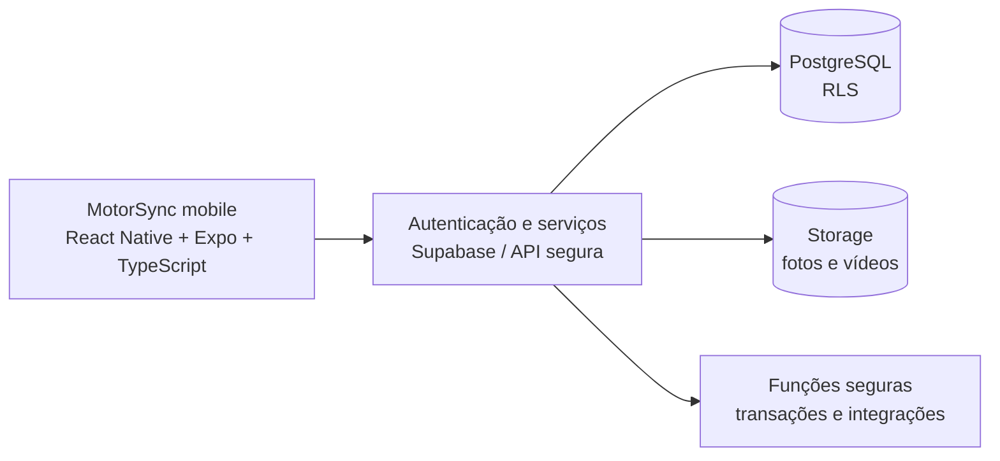

# Arquitetura proposta — MotorSync

> **Planejamento técnico, não implementação existente.** O repositório ainda não possui código React Native/Expo nem infraestrutura Supabase configurada.

## Arquitetura-alvo



Supabase é a opção preferencial para avaliação; a decisão definitiva depende de requisitos, custos e segurança. O aplicativo não deve conter chaves secretas nem executar regras críticas exclusivamente no dispositivo.

## Organização sugerida

```text
apps/mobile/
  src/app/               # rotas Expo Router
  src/components/        # UI reutilizável
  src/features/          # home, explorar, criação, gestão, perfil
  src/services/          # autenticação e chamadas de backend
  src/theme/             # tokens visuais
  src/types/
supabase/
  migrations/
  functions/
docs/
```

## Responsabilidades

| Camada | Responsabilidade |
| --- | --- |
| Mobile | UI, navegação, validação básica, prévia de mídia, acessibilidade |
| Backend | autenticação, políticas de acesso, upload, transações, integrações e auditoria |
| PostgreSQL | relações, restrições, índices e isolamento entre organizações |
| Storage | persistência e controle de acesso de fotos e vídeos |

## Transações comerciais

1. Criar anúncio vinculado ao proprietário e, opcionalmente, a uma organização.
2. Criar proposta com comprador, anunciante e anúncio validado.
3. Aceitar proposta com verificação concorrente do status e reserva do veículo.
4. Concluir venda sem duplicidade; atualizar disponibilidade e histórico no mesmo fluxo consistente.
5. Impedir remoção de registros vinculados a vendas ou propostas aceitas sem fluxo autorizado.

## Segurança e privacidade

- RLS por usuário, organização e papel.
- Validação no servidor para custos, propostas, reservas e vendas.
- Não confiar em controles meramente visuais.
- Credenciais fora do Git; somente `.env.example` pode ser versionado.
- Tratar dados pessoais segundo requisitos legais aplicáveis.
- Mídia com fallback, estados de falha e política de retenção.

## Migração do protótipo

O HTML atual é **referência de interface e comportamento**. Não deve ser incorporado como uma WebView única na versão de produção. Componentes e regras devem ser reconstruídos e testados em React Native.

Veja [modelo de dados](modelo-de-dados.md) e [roadmap](roadmap.md).
