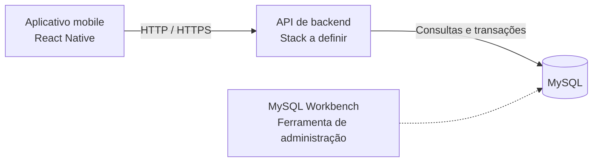

# Arquitetura proposta

Esta documentação descreve uma **direção técnica planejada**. Não há componentes em execução no repositório.

## Visão geral

A tecnologia da API ainda será selecionada. O MySQL Workbench serve para modelar e administrar o banco; não substitui o servidor MySQL.

## Responsabilidades previstas

| Camada | Responsabilidade |
| --- | --- |
| Mobile | Telas, navegação, formulários, estados de carregamento e feedback |
| API | Autenticação, autorização, validação, regras de negócio e acesso a dados |
| Banco | Armazenamento relacional de usuários, veículos, clientes e negociações |

## Fluxos importantes

**Estoque:** formulário no app → API valida dados → MySQL armazena → API retorna confirmação → app atualiza listagem.

**Venda:** vendedor vincula cliente e veículo → API valida a negociação → registra proposta/venda → ao concluir, atualiza disponibilidade com controle de consistência.

**Área gerencial:** o app apresenta apenas rotas permitidas, mas a API também precisa verificar o perfil antes de retornar dados restritos.

## Diretrizes de implementação

- Não colocar credenciais MySQL no aplicativo.
- Não armazenar senhas em texto puro; usar hash apropriado.
- Validar dados no cliente e no servidor.
- Usar consultas parametrizadas e regras de autorização na API.
- Nunca expor custos/margens apenas porque a interface ocultou ou mostrou um botão.
- Configurações locais e segredos devem ficar fora do versionamento.

## Decisões pendentes

- Framework/runtime do backend.
- Estratégia de sessão/autenticação.
- Convenção de rotas e validação.
- Modelo lógico definitivo, migrações e transações.
- Estratégia de testes automatizados.
- Organização dos diretórios de código quando o app for inicializado.

Consulte o [modelo de dados](modelo-de-dados.md) e o [roadmap](roadmap.md). Nenhuma dessas decisões deve ser apresentada como implementada antes de existir código.
