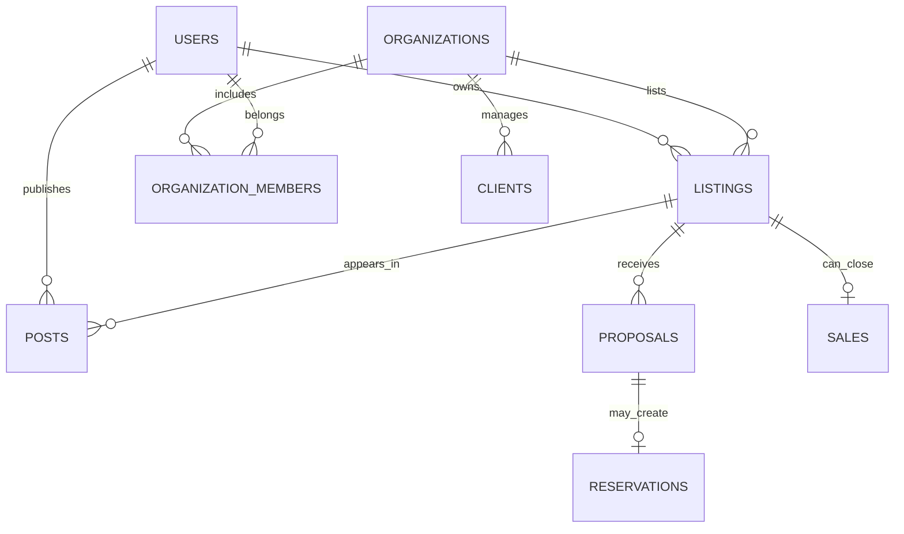

# Modelo de dados proposto — MotorSync

**Estado:** planejamento conceitual para PostgreSQL. Nenhuma tabela real ou migração foi criada neste repositório.

## Núcleo social e usuários

| Entidade | Propósito |
| --- | --- |
| users / profiles | Identidade, informações públicas e preferências |
| organizations | Empresas que usam os módulos de Gestão |
| organization_members | Vínculo de usuários, papéis e permissões |
| posts | Publicações de foto, vídeo ou texto |
| media_assets | Referências persistentes às mídias e seu estado |
| follows / likes / comments / saves | Relacionamentos e interações do feed |

## Marketplace

| Entidade | Propósito |
| --- | --- |
| listings | Anúncio, titularidade, categoria, visibilidade e status |
| vehicles | Dados específicos dos veículos |
| parts | Características e estoque de peças |
| listing_media | Fotos/vídeos pertencentes ao anúncio |
| favorites | Anúncios favoritos |
| proposals | Negociação entre comprador e anunciante |
| reservations | Reserva associada à proposta válida |

As publicações podem referenciar um `listing_id` para conectar Home e Explorar.

## Gestão ERP/CRM

| Entidade | Propósito |
| --- | --- |
| clients | Pessoas/leads com permissões por organização |
| sales | Vendas confirmadas e histórico |
| expenses | Aquisição, preparação e outras despesas vinculadas |
| financial_entries | Lançamentos financeiros autorizados |
| work_orders / tasks | Operações, responsáveis e prazos |
| documents / contracts | Metadados e trilhas documentais |
| conversations / messages | Mensagens e notificações, com políticas de acesso |

## Relacionamentos essenciais

## Regras e decisões pendentes

- Não pode existir venda duplicada para um único item indivisível.
- Proposta aceita deve respeitar status e concorrência da reserva.
- Registros financeiros restritos nunca devem ser acessíveis fora da organização autorizada.
- Excluir veículo com venda concluída deve ser bloqueado ou auditado por processo autorizado.
- Armazenar custos e preços de venda em campos separados.
- Esquema definitivo, tipos, índices, RLS, transações e migrações ainda serão definidos e testados.

Consulte [arquitetura](arquitetura.md).
