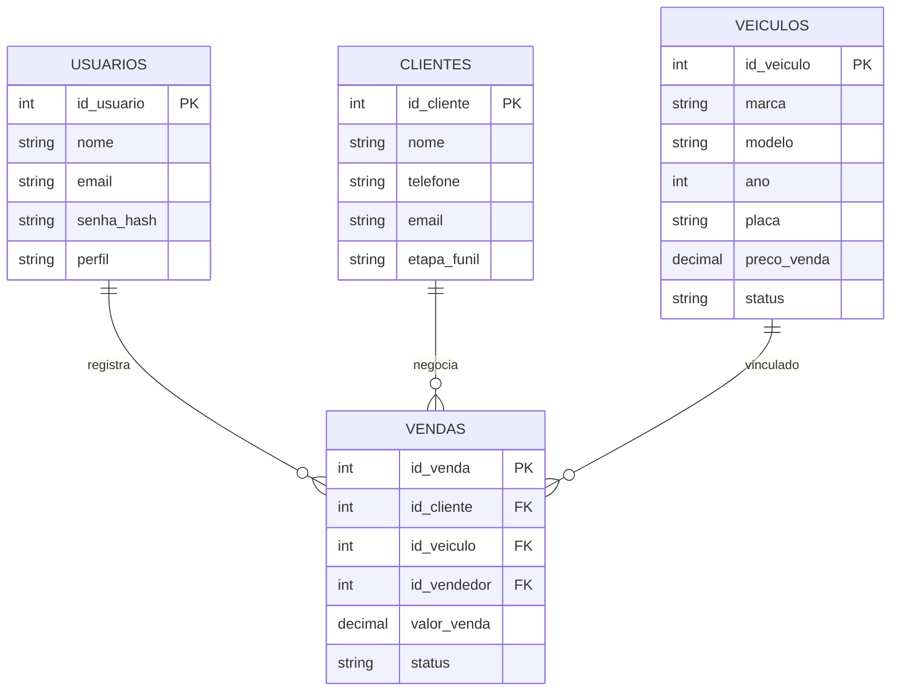

# Modelo inicial de dados

**Situação:** modelo conceitual em elaboração para MySQL. As entidades abaixo ainda **não foram criadas** em um banco no repositório.

## Entidades propostas

### Veículos

| Campo | Finalidade |
| --- | --- |
| id_veiculo | Identificador (PK) |
| marca, modelo, ano, placa | Identificação do veículo |
| cor, km, combustivel | Características |
| preco_venda | Preço anunciado |
| status | Disponível, reservado, em preparação, vendido |
| data_entrada | Referência para o tempo de estoque |

### Clientes

| Campo | Finalidade |
| --- | --- |
| id_cliente | Identificador (PK) |
| nome, telefone, email, CPF | Contato e identificação |
| interesse_compra, etapa_funil | Acompanhamento comercial |
| ultimo_contato, proximo_followup | Histórico e ações futuras |

### Usuários

| Campo | Finalidade |
| --- | --- |
| id_usuario | Identificador (PK) |
| nome, email | Identificação |
| senha_hash | Autenticação sem armazenar senha em texto puro |
| perfil | Vendedor, gerente ou administrador |

### Vendas e propostas

| Campo | Finalidade |
| --- | --- |
| id_venda | Identificador (PK) |
| id_cliente, id_veiculo, id_vendedor | Relacionamentos (FK) |
| data, valor_venda, status | Negociação |
| forma_pagamento, valor_entrada | Condições comerciais |
| veiculo_troca, termo_garantia, observacoes | Detalhes complementares |

Os campos foram consolidados a partir do planejamento e das telas demonstrativas; **não são um esquema SQL definitivo**.

## Relações principais

## Regras ainda a definir

- Um veículo pode receber várias propostas, mas não deve ter mais de uma venda concluída.
- Propostas e vendas podem compartilhar entidade e diferir por status, a confirmar.
- Interesse de cliente em múltiplos veículos pode exigir tabela de associação.
- Exclusão de veículo/cliente precisa respeitar vínculos existentes.
- Margem requer custo de aquisição e gasto de preparação.
- Tempo de estoque depende da entrada do veículo e do encerramento da permanência.
- Comissões exigem definição formal da regra de cálculo.
- Tipos MySQL, índices, restrições e chaves serão refinados na implementação.

Mais detalhes de contexto estão em [visão geral](visao-geral.md).
