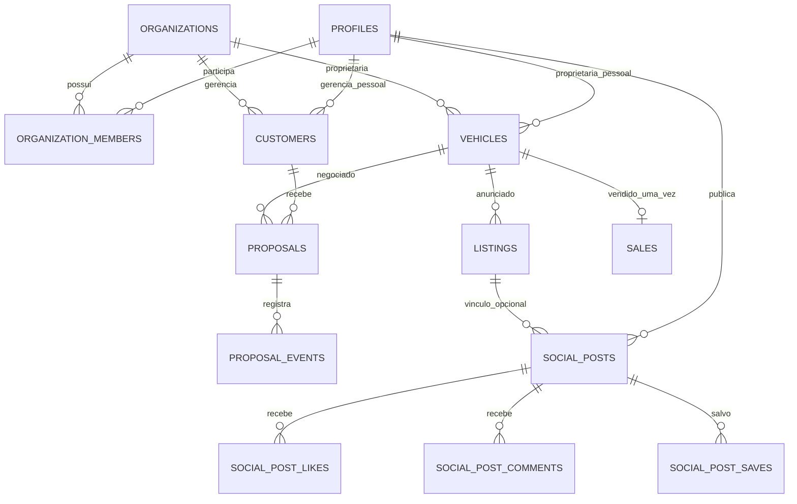

# MotorSync — modelo de dados conforme o snapshot de 11/11/2026

O ZIP contém migrações PostgreSQL para identidade/organizações, veículos, anúncios, fluxo comercial, gestão pessoal, feed social e favoritos privados de anúncios. A presença de um arquivo SQL no ZIP não prova que foi aplicado ao banco remoto.

## Entidades encontradas nas migrações

| Área | Entidades/tabelas | Papel |
| --- | --- | --- |
| Identidade | `profiles`, `organizations`, `organization_members` | Perfil, empresas e associação/permissões |
| Estoque e marketplace | `vehicles`, `listings` | Veículos e anúncios vinculados |
| CRM/comercial | `customers`, `proposals`, `proposal_events`, `sales` | Clientes, negociações, eventos e vendas |
| Social | `social_posts`, `social_post_likes`, `social_post_comments`, `social_post_saves` | Posts, curtidas, comentários/respostas e posts salvos |
| Favoritos de anúncios | `listing_favorites` | Favoritos privados de anúncios; migração presente, aplicação remota não confirmada |
| Mídia | Buckets `listing-photos`, `social-post-images` | Fotos de anúncios e posts, com políticas específicas |

## Relacionamentos conceituais

O diagrama é uma síntese conceitual; não substitui colunas, constraints, índices, funções ou chaves compostas dos SQLs em `supabase/migrations/`.

## Regras de integridade

- Propriedade pessoal e empresarial usa escopos separados.
- Acesso empresarial exige associação e autorização.
- Status de veículo: em preparação, disponível, reservado, vendido.
- Proposta enviada ou aceita não conclui venda.
- A conclusão de venda precisa ocorrer em transação no backend e impedir venda duplicada.
- Custos internos, dados de clientes e informações financeiras não podem ser expostos no anúncio.
- Post social pode ter vínculo opcional com anúncio autorizado.
- `social_post_saves` e `listing_favorites` são conceitos diferentes e privados por usuário.

## Estado remoto a confirmar

A documentação específica do pacote descreve a migração social como aplicada em 10/11/2026 ao Supabase de desenvolvimento. A migração de favoritos privados tem contradição entre o README e os documentos técnicos: não afirmar que está aplicada até consultar o histórico remoto. Não reaplicar migrações sem essa verificação.
