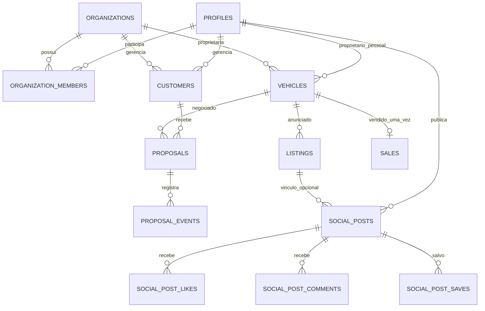

# MotorSync — modelo lógico do banco

**Base documental:** migrações SQL incluídas no snapshot editorial de 11/11/2026.  
**Atenção:** este modelo resume as estruturas presentes nas migrações; não substitui consulta ao esquema remoto nem comprova que cada migração foi aplicada.

## Entidades principais

| Entidade | Finalidade |
| --- | --- |
| `auth.users` / `profiles` | Identidade autenticada e dados de perfil |
| `organizations` | Organizações/empresas |
| `organization_members` | Vínculo entre usuário, organização e papel/permissão |
| `vehicles` | Veículos do estoque, com propriedade pessoal ou empresarial |
| `listings` | Anúncios públicos ou rascunhos, atributos e mídias |
| `customers` | Clientes sob escopo pessoal ou empresarial |
| `proposals` | Propostas comerciais e vínculo com cliente/veículo/anúncio |
| `proposal_events` | Histórico de eventos das propostas |
| `sales` | Vendas concluídas e vínculos comerciais |
| `social_posts` | Publicações da comunidade |
| `social_post_likes` | Curtidas de publicações |
| `social_post_comments` | Comentários e respostas |
| `social_post_saves` | Publicações salvas por usuário |
| `listing_favorites` | Favoritos privados de anúncios; migração presente no ZIP, aplicação remota não confirmada |

## Relacionamentos conceituais

O diagrama é conceitual e não reproduz todas as colunas, índices, chaves compostas, constraints ou funções SQL. A definição exata está nos arquivos `supabase/migrations/*.sql`.

## Regras de integridade

- Dados pessoais e empresariais devem ter escopos de propriedade distintos.
- Acesso empresarial exige vínculo autorizado em `organization_members`.
- Veículos usam estados em preparação, disponível, reservado e vendido.
- Proposta aceita não conclui venda.
- A conclusão da venda deve ocorrer por transação no backend, evitando duas vendas para o mesmo veículo.
- Custos e valores internos não podem ser expostos nos anúncios públicos.
- Posts sociais podem ter vínculo opcional com anúncio autorizado.
- Favoritos de posts (`social_post_saves`) e favoritos de anúncios (`listing_favorites`) são conceitos distintos e devem permanecer privados por usuário.

## Estado das migrações

A documentação do ZIP descreve a migração social como aplicada ao Supabase de desenvolvimento em 10/11/2026. A migração de favoritos de anúncios tem status contraditório entre README e documentação técnica; tratar como **não confirmada remotamente** até consultar o histórico do projeto Supabase. Nunca reaplicar uma migração sem essa conferência.
